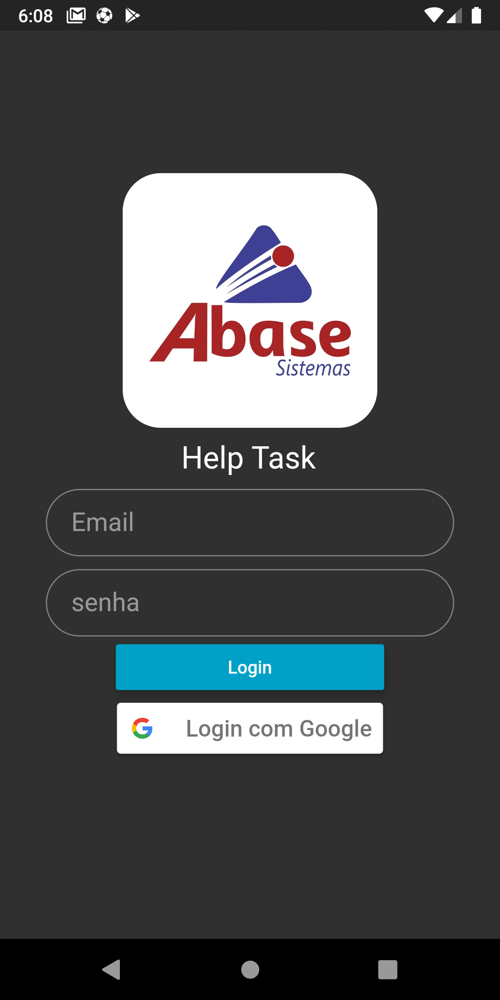
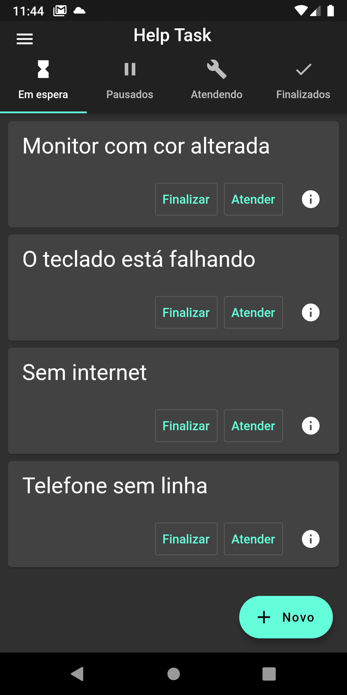
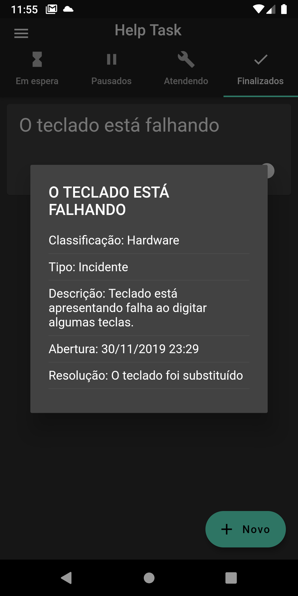
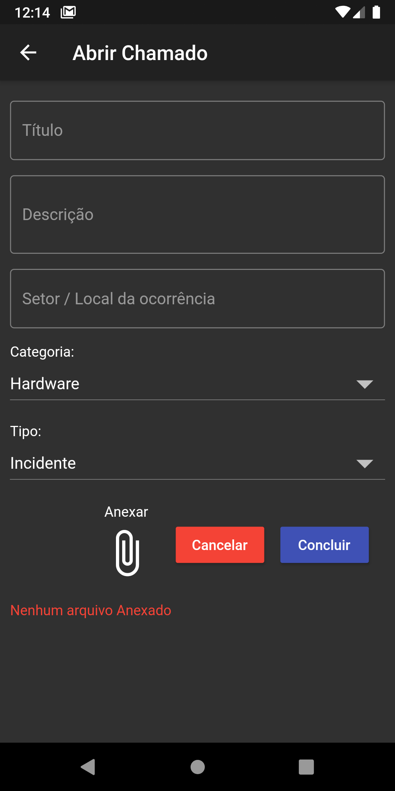
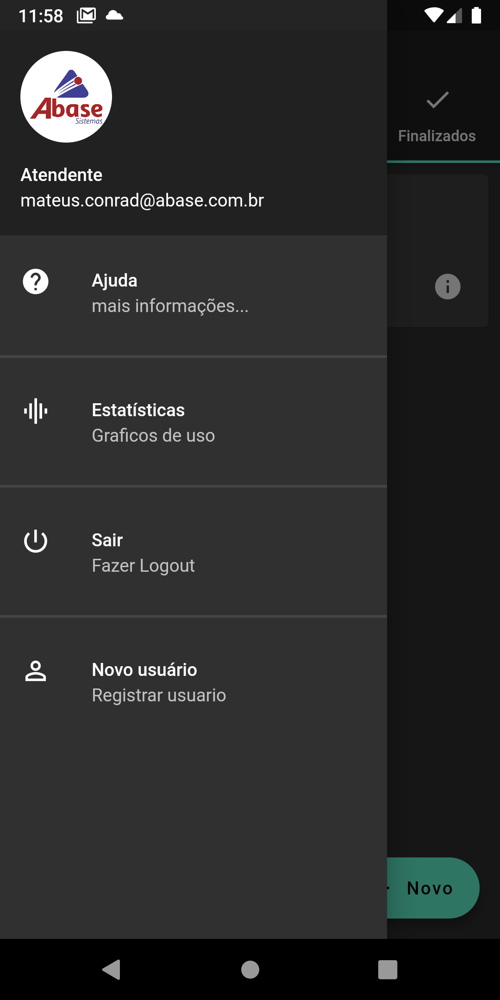

# Help Task

Aplicativo mobile de abertura e acompanhamento de chamados de suporte, feito em **Flutter** com **Firebase**. Foi desenvolvido em 2019 como trabalho do Interdisciplinar III, que uniu as disciplinas de Linguagem de Programação III e Alinhamento e Estratégias de Sistemas.

## Funcionalidades

- **Dois perfis de acesso**
  - Usuário: entra com a conta Google
  - Atendente: entra com usuário e senha
- **Abertura de chamados**, com categoria, tipo, prioridade e anexo de arquivo
- **Acompanhamento por status**, em abas: em espera, em andamento, pausados e finalizados
- **Detalhes do chamado**
- **Gráficos** com dados dos chamados
- **Tela de ajuda** com a documentação em PDF

## Telas

| Login | Em espera | Detalhes |
|:---:|:---:|:---:|
|  |  |  |

| Abrir chamado | Menu lateral |
|:---:|:---:|
|  |  |

## Tecnologias

- Flutter / Dart
- Firebase Authentication (login com Google e com e-mail e senha)
- Cloud Firestore (armazenamento dos chamados e usuários)
- Firebase Storage (anexos)
- charts_flutter (gráficos)

## Documentação acadêmica

- [Relatório](relatorio/Relatório.pdf)
- [Resumo expandido](relatorio/ResumoExpandido.pdf)
- [Documentação do sistema](relatorio/DocumentaçãoHelpTask.pdf)
- Diagramas: [casos de uso](relatorio/imagens/Diagramas/diagrama_caso_de_uso.png) · [classes](relatorio/imagens/Diagramas/diagrama_classes.png) · [processos](relatorio/imagens/Diagramas/diagrama_processos.png)

O relatório usa como base o template LaTeX SETREM, disponibilizado pelo [LARCC](http://larcc.setrem.com.br/).

## Observação

Este é um projeto acadêmico de 2019. Ele usa versões antigas do Flutter (Dart `>=2.2.2 <3.0.0`) e dos plugins do Firebase, então provavelmente não compila em um SDK atual sem atualizar as dependências.
